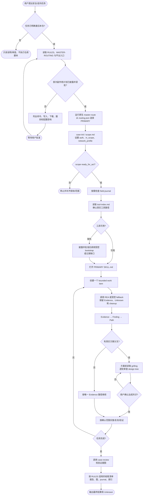
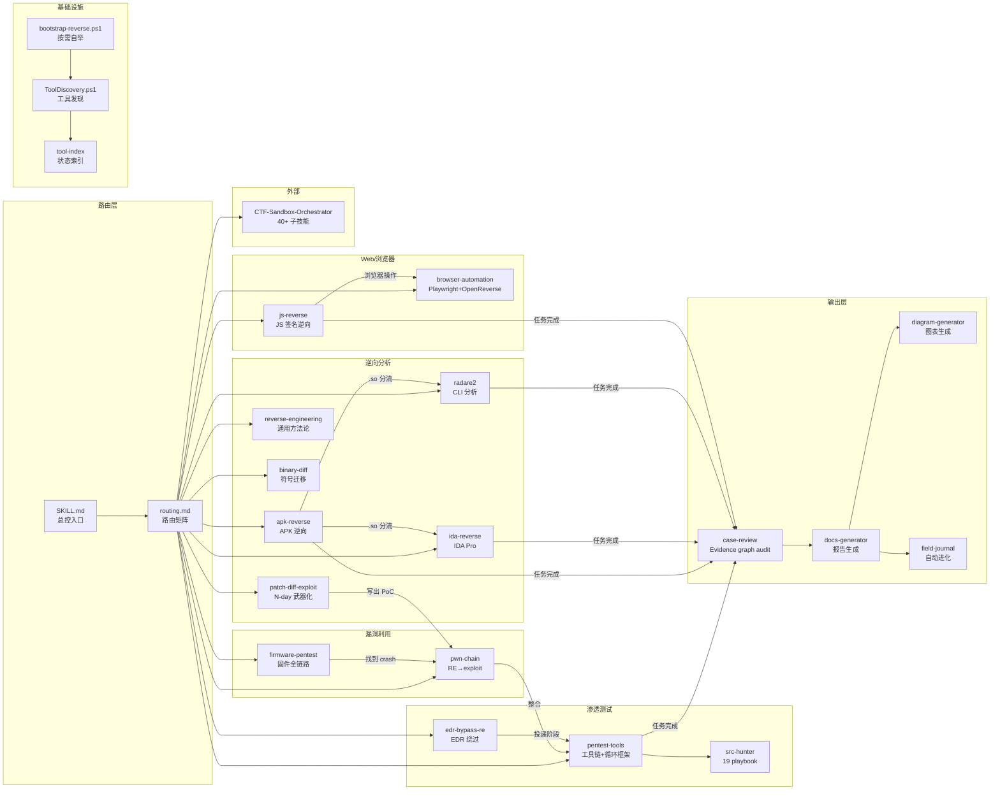
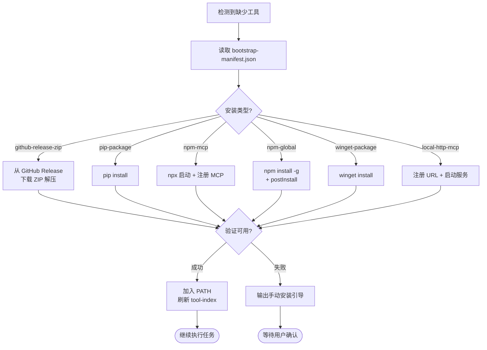
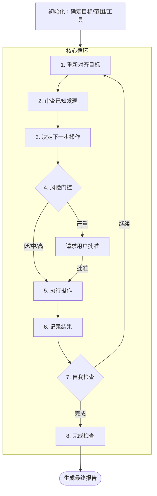
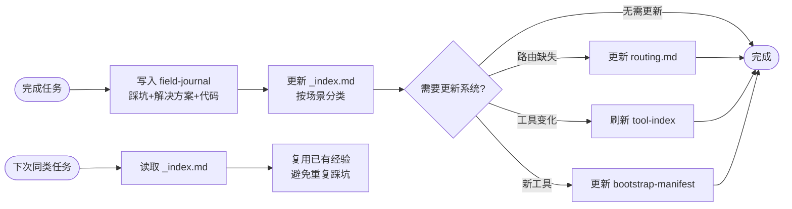
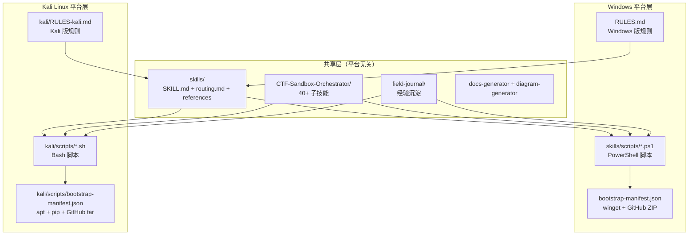
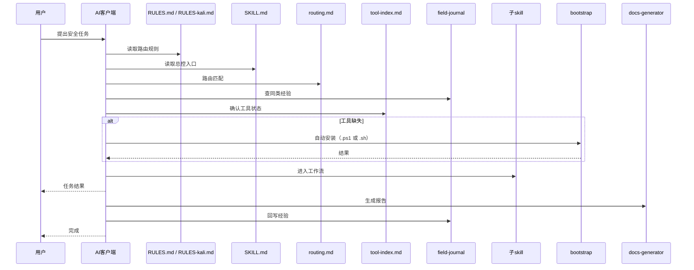

# 系统架构图

## 原版兼容边界

本仓库在原版 `reverse-skill` 上做增量扩展。原路由事实源、相对优先级、scope/auth 门、Evidence 契约和原 benchmark 继续有效；困难目标参考资料不改变 PRIMARY，也不把 REA、Spec Kit 或某个宿主变成硬依赖。维护和审查规则见 [ORIGINAL-COMPATIBILITY-CONTRACT.md](ORIGINAL-COMPATIBILITY-CONTRACT.md)。

图中的 `routing.json` 是唯一路由事实源；`routing.md` 只用于歧义解释，不直接修改。`grilling` 是 Pi 适配层的可选伴随技能，不属于本仓库的客户端中立核心。

## Skills 模块关系图

## Bootstrap 自举流程

## 渗透测试循环

## 自动进化机制

## 多平台支持架构

### 平台选择逻辑

| 环境 | 使用的规则文件 | 使用的脚本 | 包管理 |
|------|--------------|-----------|--------|
| Windows | `RULES.md` | `skills/scripts/*.ps1` | winget / GitHub Release ZIP |
| Kali Linux | `kali/RULES-kali.md` | `kali/scripts/*.sh` | apt / pip / npm / GitHub tar.gz |

### Kali 版特点

- **大量工具预装**：nmap、sqlmap、hashcat、hydra、metasploit、radare2、binwalk、burpsuite 等无需 bootstrap
- **apt 统一管理**：不需要 winget、不需要手动解压 ZIP
- **bash 原生**：脚本更简洁，无 PowerShell 依赖
- **路径规范**：`/usr/bin/`、`/opt/`、`~/tools/`，无盘符和空格问题

## 文件读取时序图

